# PES6 HD Text

**The first PES 6 mod that makes the game's text sharp in HD: same fonts, same layout, and it works with any patch.**

A Kitserver 6 module for Pro Evolution Soccer 6 (PC) by **pitycharly**. Version 1.0.1.

**[⬇ Download PES6 HD Text 1.0.1](https://github.com/angelballay/pes6-hd-text/releases/latest)** · [What's new](#whats-new-in-101) · [Install](#install) · [Choosing a font](#choosing-a-font) · [With your patch's font](#using-it-with-your-patchs-font) · [Compatibility](#compatibility) · [Known limitations](#known-limitations) · [Changelog](CHANGELOG.md) · [Español](#español)

## What's new in 1.0.1

- **HD fonts:** with an HD font the text is drawn at the resolution of your screen instead of being stretched from 640x480 (tested at 1920x1080).
- **18 HD fonts included:** `HD_original_font` keeps the original PES 6 look, and 17 more change the style, from clean sans to pixel, marker or stencil.
- **`pes6_hd_text.exe`, a settings tool:** turn the mod on or off, pick a font with a preview, add your own fonts and go back to the font you had before.
- **Cleaner letters with the game's own fonts:** thin fonts keep their strokes, broken letters are repaired and round letters come out symmetric.
- **More text is sharp:** menu items, help texts, the match clock, and shrunk and italic labels.
- **Fixed:** club crests, flags and icons are no longer touched by mistake.

Full list in the [changelog](CHANGELOG.md).

## Before / after

Every image compares the same screen. "No mod" is the game without the mod; only the modded side is rescaled to line them up, so the comparison never favours the mod.

**Original PES 6, line-up:** no mod, the game font sharpened 2x, and HD_original_font

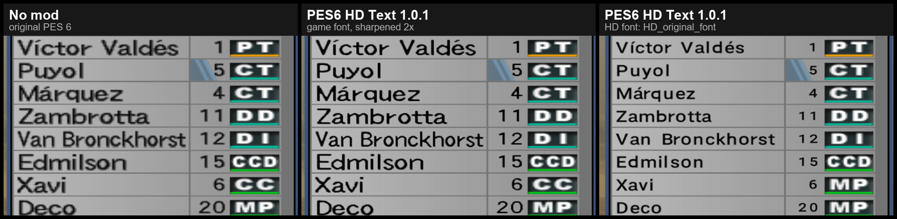

**PES 6 The Den Patch 2026, line-up:** no mod, its own font sharpened 2x, and HD_stencil (one of the 18 HD fonts)

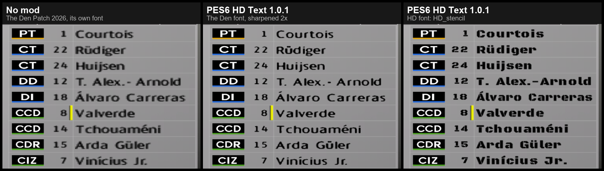

**One screen, eight looks**

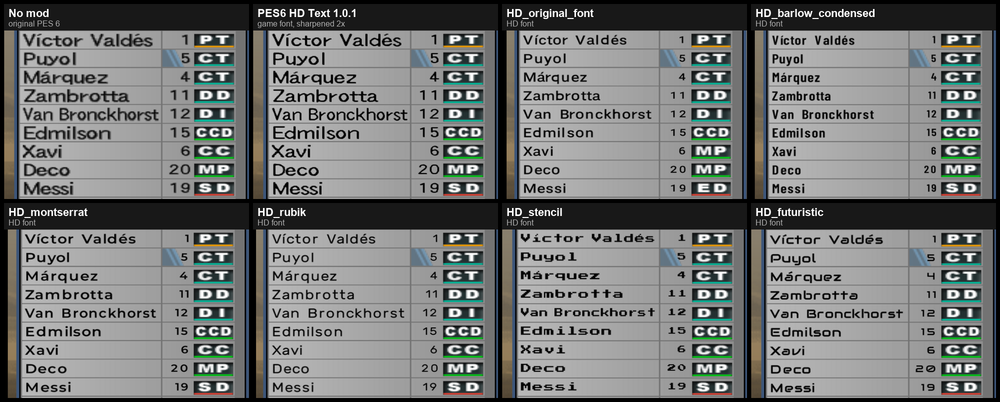

<details>
<summary><b>More comparisons</b> (pause menu, edit player, match settings, edit menu, kit selection)</summary>

**The Den Patch 2026, pause menu**

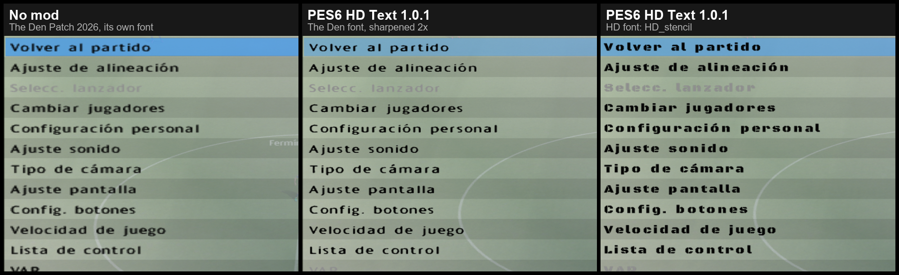

**The Den Patch 2026, edit player**

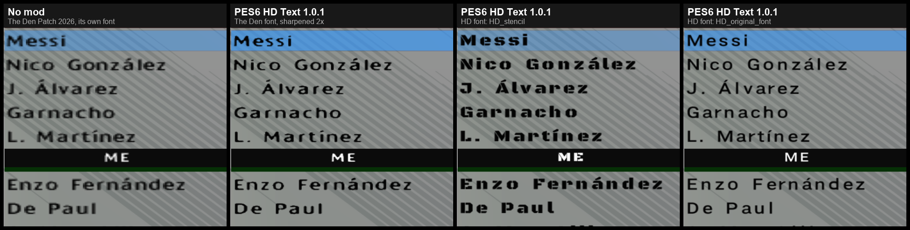

**The Den Patch 2026, match settings**

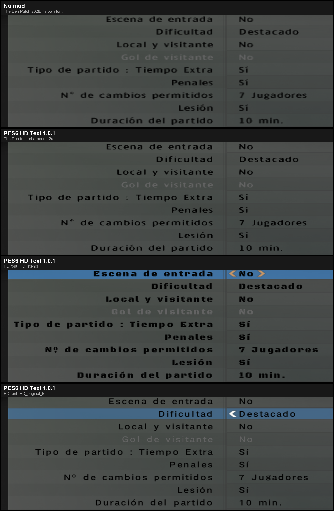

**The Den Patch 2026, edit menu**

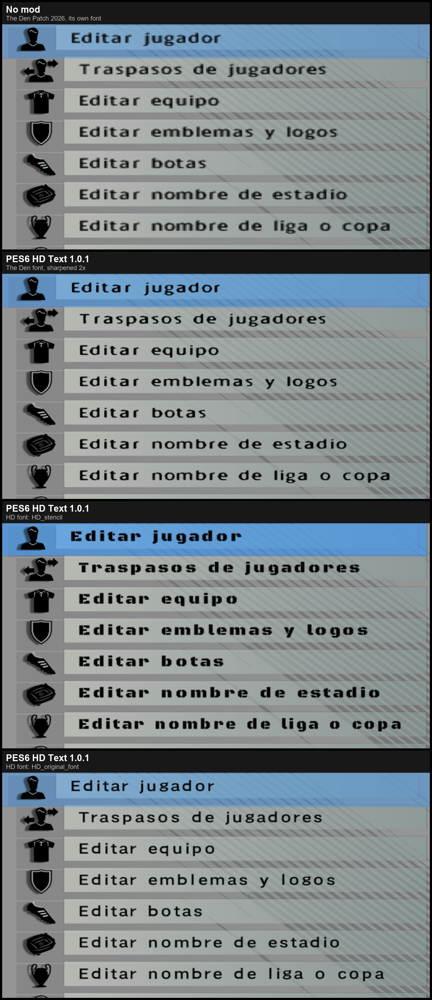

**Original PES 6, pause menu**

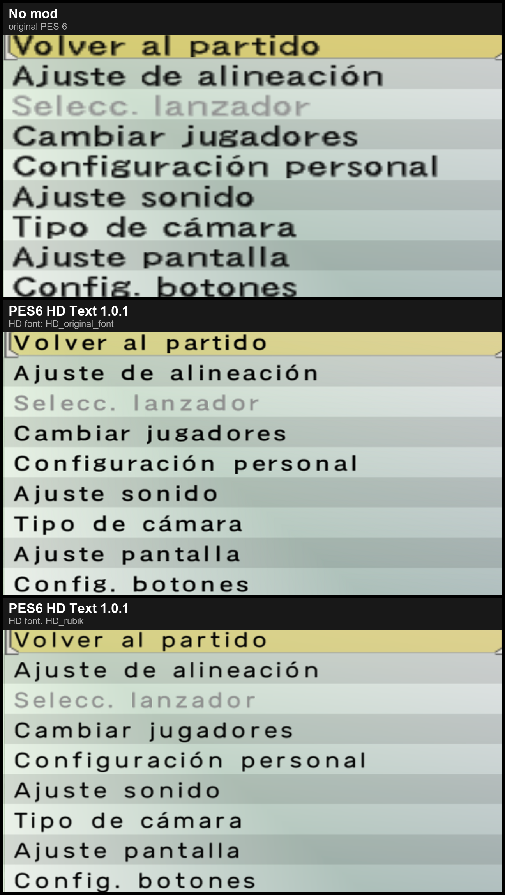

**Original PES 6, match settings**

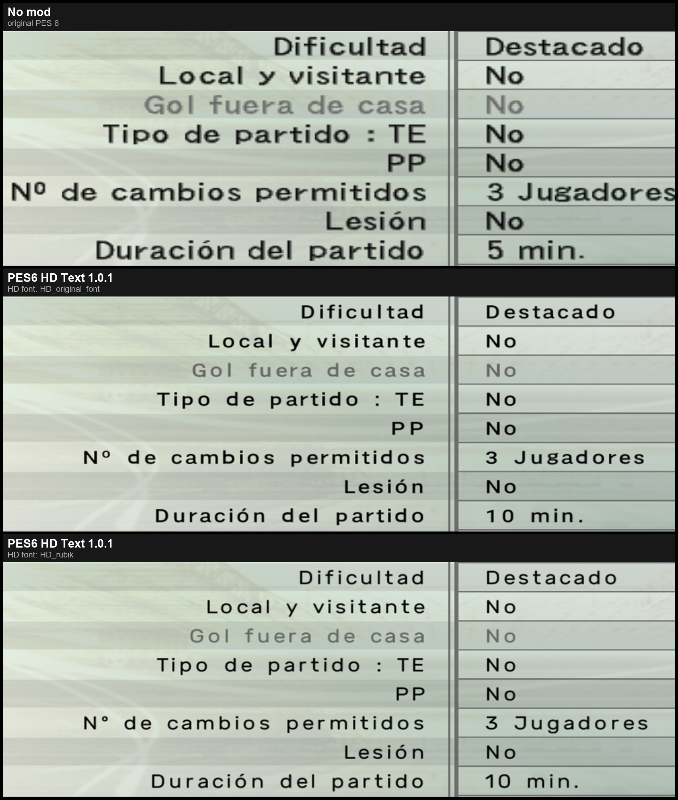

**Original PES 6, edit menu**

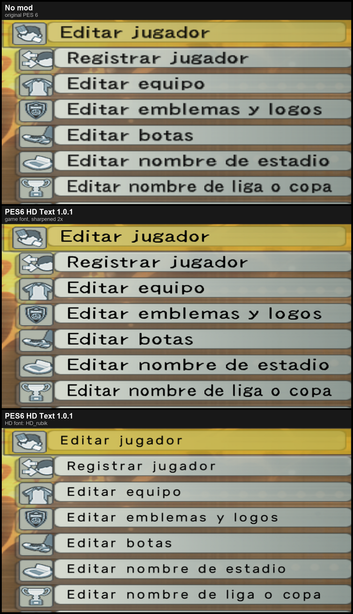

**Pause menu, four looks**

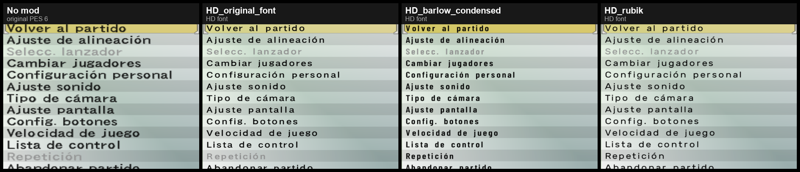

**Kit selection, two HD fonts** (no capture without the mod of this screen)

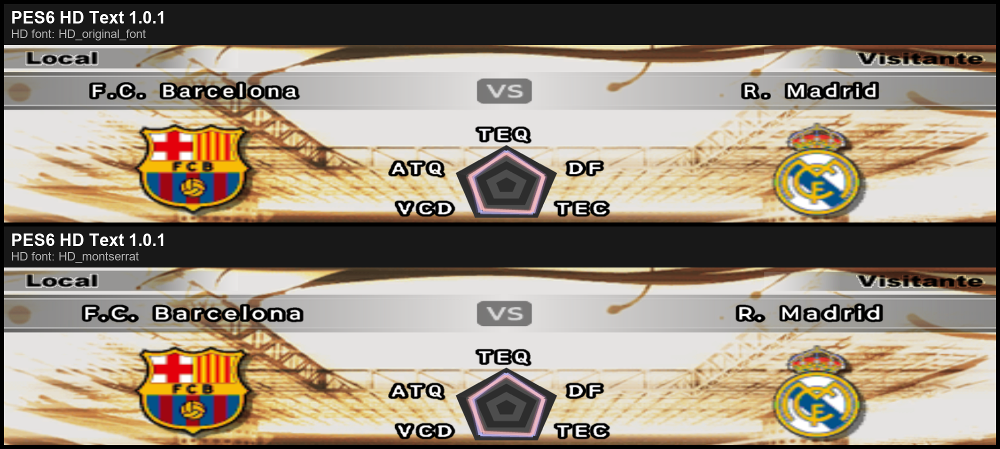

</details>

<details>
<summary><b>Screenshots of version 1.0</b> (the game's own fonts at 2x)</summary>


*Zoomed crop of the Edit Player screen: same game, same screen, left without the mod and right with it.*

#### Zoomed comparisons

Same zone of the same screen, before and after. The "after" capture is the one rescaled to line them up, so the comparison never favours the mod.

**Original PES 6**


**PES 6 The Den Patch 2026 (its own font)**


#### Full screens: original PES 6

**Edit player**

| Before | After |
|---|---|
|  |  |

<details>
<summary><b>More screens: original PES 6</b> (edit menu, team selection, match settings, line-up, pause menu)</summary>

**Edit menu**

| Before | After |
|---|---|
|  |  |

**Team selection**

| Before | After |
|---|---|
|  |  |

**Match settings**

| Before | After |
|---|---|
|  |  |

**Line-up**

| Before | After |
|---|---|
|  |  |

**Pause menu (in match)**

| Before | After |
|---|---|
|  |  |

</details>

#### Full screens: PES 6 The Den Patch 2026

<details>
<summary><b>Screens: The Den Patch 2026</b> (match settings, edit menu, line-up, pause menu)</summary>

**Match settings**

| Before | After |
|---|---|
|  |  |

**Edit menu**

| Before | After |
|---|---|
|  |  |

**Line-up**

| Before | After |
|---|---|
|  |  |

**Pause menu (in match)**

| Before | After |
|---|---|
|  |  |

</details>

</details>

## What it does

- Menus, player names, team names and titles are drawn **sharp** instead of blurry and stretched.
- **Same positions:** nothing moves and nothing gets cut. Keep your game's font, made sharp, or switch to an HD font.
- **HD fonts at your screen's resolution:** 18 included, from the original PES 6 look to pixel, marker or stencil styles.
- **Works with whatever font your patch uses.** PES 6 The Den Patch 2026 ships its own font and gets sharp too.
- **Any game language.** It works on whatever text the game draws, so it doesn't depend on the language (tested in Spanish).
- **A settings tool** (`pes6_hd_text.exe`) to turn it on or off and choose the font, with a preview.

## How it works

PES 6 draws its text with tiny 16 px bitmap fonts, and the GPU stretches them to your resolution. That is why text looks blurry on modern screens. Simply using bigger fonts breaks the layout, because the game calculates every position from the original font sizes.

PES6 HD Text doesn't touch the fonts at all:

1. The game builds each piece of text exactly as it always did, with its original fonts and sizes.
2. When the game turns that text into a Direct3D texture, the module hands over a **copy at twice the resolution**. The upscale is edge-aware: the shape of each letter comes from the alpha channel with a threshold, and the colours come from the original palette. That covers outlines and the 256-colour letters of the big titles.
3. PES 6 maps textures by the image size, so the sharper copy lands in **exactly the same rectangle** on screen.

The game recreates many of these textures over and over, so the upscaled copies are cached and menus stay smooth.

**With an HD font** the module goes further. The game draws its menus in a 640x480 space and stretches it to your screen (at 1920x1080 that is 3x wide and 2.25x tall), so even a 2x copy ends up stretched. With an HD font, each piece of text is built at 4x and then sized to exactly the density of your screen. The game still measures and places the text with its original sizes, so nothing moves.

## Install

Requires **Kitserver 6** with `afs2fs.dll` loaded in `kload.cfg` (it comes with Kitserver 6 and with most patches). Don't have it yet? [Kitserver 6](https://www.mediafire.com/file/ljbcnczm893g1b6/kitserver.rar/file)

**Updating from 1.0:** copy the zip's `Kitserver` folder over your old files and keep the `pes6_hd_text.dll` line you already have in `kload.cfg` (don't add another one). Then run `pes6_hd_text.exe` and press **Apply**.

1. Download `PES6_HD_Text_v1.0.1.zip` from [Releases](https://github.com/angelballay/pes6-hd-text/releases/latest) and copy everything inside its `Kitserver` folder into your game's Kitserver folder (the one with `kload.cfg`).
2. Open `kload.cfg` with Notepad and add a line after the last `DLL.N`, using the next number. For example, if your last line is `DLL.25`:
   ```
   DLL.26 = "kitserver\pes6_hd_text.dll"
   ```
3. Increase `DLL.num` by 1 (in the example, `DLL.num = 26` becomes `DLL.num = 27`).
4. Run `Kitserver\pes6_hd_text.exe`, pick a font and press **Apply** (see [Choosing a font](#choosing-a-font)).
5. Start the game.

## Choosing a font

`pes6_hd_text.exe` is a small settings tool that lives in your Kitserver folder.

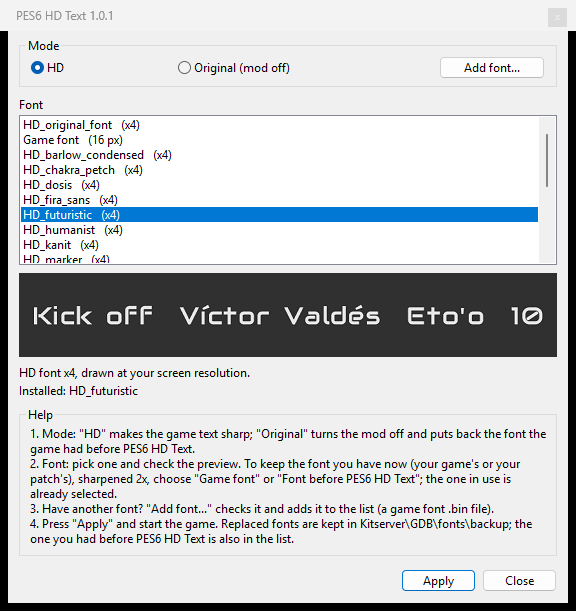

- **HD** turns the mod on. Pick a font from the list and check the preview. "Game font" keeps your game's own letters, made sharp.
- **Original (mod off)** turns the mod off and puts back the font the game had before PES6 HD Text.
- **Add font...** adds your own font file (`.bin`, the game's font 53 format). It is checked first, and files that are not a valid font are rejected.
- **Installed** shows the font the game uses right now. It checks the file contents; if a font was installed by another tool or patch and is not one it knows, it says "unknown".
- Fonts live in `Kitserver\GDB\fonts`, and the installed one is copied to `Kitserver\dat\0_text.afs`. Every replaced font is kept in `Kitserver\GDB\fonts\backup`, and the one you had before PES6 HD Text stays in the list as "Font before PES6 HD Text".
- Windows asks for permission when you open it, because it writes in the game folder (often inside Program Files).

## Using it with your patch's font

PES6 HD Text works with the font your patch already has. Open `pes6_hd_text.exe` and choose:

| You want | In `pes6_hd_text.exe` |
|---|---|
| **Your patch's font, sharpened 2x** | Leave **HD** and the selected font as they are, and press **Apply**. The font in use is already selected. |
| **An HD font instead** | **HD**, pick an `HD_…` font, **Apply**. Your patch's font is saved and stays in the list. |
| **Back to your patch's font, still sharp** | **HD**, select it again, **Apply**. |
| **Back to your patch's font, without the mod** | **Original (mod off)**, **Apply**. The font comes back exactly as the patch had it, and the mod stops doing anything. |

Where your patch's font shows up in the list:

- **"Game font"** if the patch keeps it inside the game's own files (`dat\0_text.afs`), as PES 6 The Den Patch 2026 does. "Installed" then says *game font (The Den Patch 2026)*.
- **"Font before PES6 HD Text"** if the patch installed it with Kitserver (`Kitserver\dat\0_text.afs\unknow_00053.bin` or `unnamed_53*.bin`). The first time you open the tool, it is copied to `Kitserver\GDB\fonts\backup\before_pes6_hd_text`.

If your patch ships a font that is already bigger than the original (an HD font), the mod detects it and uses it as HD by itself.

## Uninstall

1. Run `pes6_hd_text.exe`, choose **Original (mod off)** and press **Apply**. This puts back the font you had before.
2. Remove the `pes6_hd_text.dll` line from `kload.cfg` and put `DLL.num` back to its previous value.
3. Delete `pes6_hd_text.dll`, `pes6_hd_text.exe`, `pes6_hd_text.cfg` and the `Kitserver\GDB\fonts` folder.

Don't leave an HD font installed without the DLL: the game can't load an HD font on its own.

## How the mod handles each font

When the game loads a font, the mod compares its size with the original size of that font (the text font, entry 53, is 16x16 per letter cell):

- **Original size** (the game's font or your patch's font): each piece of text is made sharp at 2x.
- **Bigger, so it's an HD font:** the game is handed a copy shrunk back to the original size, so it measures and places every text exactly as always, and the HD letters are what ends up on screen.
- **HD at 4x or more** (like the 18 included): each text is built at 4x and then sized to exactly the pixel density of your screen.
- **Smaller than the original, or unreadable:** left as it is.

Any scale works (2x, 3x, 4x, even non-integer), with grey, coloured or black-outlined palettes, 16 or 256 colours, and for any of the game's fonts, not only the text font. With 4x fonts the game's letter-pair spacing table is turned off, so letters drawn from a TTF don't stick together.

### Installing a font by hand

Copy the `.bin` to `Kitserver\dat\0_text.afs\` as `unnamed_53_<anything>.bin` and make sure no other `unnamed_53*` or `unknow_00053*` file is there. That is all the tool does, plus the backup.

## For font makers

If you make fonts for PES 6, HD versions are very welcome:

- Same format as the game's font file (`0_text.afs` entry 53 for the text font), with the same letter table.
- 16 colours, and every letter cell at an integer multiple of the original (2x, 3x, 4x...). 4x gives the best result.
- For a widescreen look, draw the letters 0.75 times as wide: the game stretches its menus from 4:3 to 16:9.

"Add font..." in the tool checks all of this and says what is wrong. Share yours in an [issue](https://github.com/angelballay/pes6-hd-text/issues) and it can join the next version, with your credit.

## For mod makers: hooked functions

Each hook is a 5-byte jump at the start of a function of `pes6.exe` (PC). Before writing, the mod checks that the original bytes are there; if another mod already changed one of these spots, it skips that part (or does nothing at all) and the game keeps running. If your mod hooks any of these, let's coordinate in an [issue](https://github.com/angelballay/pes6-hd-text/issues).

| Address | What the game does there | Why PES6 HD Text hooks it |
|---|---|---|
| `0x0087A810` | TexAdd: every image enters the texture system | marks which images are text |
| `0x0040C270` | builds a Direct3D texture from a game image | hands over the sharp copy |
| `0x00953350` | creates a text object | marks the text image |
| `0x00953080` | composes the image of a text, letter by letter | rebuilds shadow text with sharp letters |
| `0x00953660` | registers an image | follows text images |
| `0x00958FA0` | rescales a text (menu labels) | sharp shrunk labels |
| `0x00958EA0` | slants a text (italic labels) | sharp italic labels |
| `0x0095A1E0` | adds a letter to a letter sheet (menus, help, clock) | sharp letter sheets |
| `0x00959780` | draws a letter into a letter sheet | keeps the sharp sheet in step |
| `0x008D18C0` | copies pixels into an image | keeps the sharp sheet in step |
| `0x0094D920` | a font finished loading | HD font detection |
| `0x0094DD20` | a font is freed | gives the game back its own font data |
| `0x00959520` | prepares a font's letter-pair spacing | turned off for 4x fonts |

It also calls Direct3D 8 `CreateTexture` on the game's device (no hook there). [Change Physics Game](https://github.com/angelballay/pes6_game_physics_mod) hooks `0x005A5905`, `0x005A637B`, `0x005ADEC9`, `0x005AF6D6`, `0x005AFB43` and `0x0047810D`: no overlap, and both run together in The Den Patch 2026.

## Compatibility

- Tested on the **original PES 6** + Kitserver 6.
- Tested on **PES 6 The Den Patch 2026**, together with its 26 other Kitserver modules, including [Change Physics Game](https://github.com/angelballay/pes6_game_physics_mod).
- Before changing anything, the module checks the game code where it hooks. If your `pes6.exe` is different, it does nothing and the game runs as usual.
- In "Original" mode the DLL hooks nothing: the game is exactly as without the mod.
- Sharp copies use at most 64 MB of memory with the game's own fonts, plus up to 64 MB more with HD fonts.

## Known limitations

- **Text only.** Graphics that are images stay as they are: the title screen ("Press any button"), logos, icons, menu widgets and the scoreboard numbers (they are part of a texture).
- **Big outlined titles keep the game's original outline,** so letters that overlap slightly in the original still overlap (now sharp).
- **Not a widescreen fix:** the menu layer is still 4:3, stretched to your screen.

Since it only touches text, it should sit nicely next to texture packs and other HD projects.

## FAQ

**Does it change the font?** Only if you want. "Game font" keeps the exact fonts your game or patch already has; the HD fonts are optional and you can go back at any time.

**Will text move or get cut?** No. Every size and position is the game's own; only the texture behind the text is sharper.

**Does it slow the game down?** No noticeable impact. Each text texture is upscaled once and then reused from a cache.

## For patch makers

PES6 HD Text is a plain Kitserver module that runs next to whatever your patch already has. If you want to include it in your patch, go ahead: just add this line to your patch credits, as the [license](LICENSE) requires:

> Mod PES6 HD Text Original creado por PityCharly.

And let me know if anything conflicts (open an [issue](https://github.com/angelballay/pes6-hd-text/issues)).

## Thanks

Thanks to **The Den** for *PES 6 The Den Patch 2026*, the patch where PES6 HD Text was tested next to 26 other Kitserver modules and with its own font.

Thanks to **SimoneZ**: `HD_original_font` is based on their work (Roboto, Apache 2.0).

## License

[MIT](LICENSE), with one extra condition: any patch, mod or project that includes or reuses PES6 HD Text, fully or partly, must show this line in its credits: *"Mod PES6 HD Text Original creado por PityCharly."*

The included HD fonts are modified versions of free fonts (SIL Open Font License and Apache 2.0). The download lists each one with its source font and license in `Kitserver\GDB\fonts\FONT_LICENSES.txt`.

## Feedback

Found a screen where the text is still blurry? Open an [issue](https://github.com/angelballay/pes6-hd-text/issues) with a screenshot and the patch you use.

## About the author

I'm **pitycharly**, an Argentine software developer who makes mods for PES 6. I want to help keep this game alive, and I'd love to see my mods inside the patches people already play. I build them as Kitserver modules and keep them compatible with all the existing ones.

My other mod:

- **[Change Physics Game](https://github.com/angelballay/pes6_game_physics_mod)** (v1.1): first-time passes no longer die on the pitch. A faster pass impulse makes the ball roll faster and more smoothly. Tested on the original PES 6 and on PES 6 The Den Patch 2026. [Video](https://www.youtube.com/watch?v=KKfPKn4rNsg) · [Download](https://www.mediafire.com/file/fwqcw1omr98uekw/1.1_pes6_game_physics_mod.zip/file)

---

## Español

**El primer mod de PES 6 que pone el texto del juego nítido en HD: mismas fuentes, mismo diseño, y anda con cualquier parche.**

Los menús, los nombres de jugadores y de equipos y los títulos se ven nítidos en lugar de borrosos y estirados. El juego sigue usando sus posiciones: nada se mueve ni se corta. Podés quedarte con la fuente de tu juego, ahora nítida, o elegir una fuente HD.

**Novedades de la 1.0.1** (lista completa en el [changelog](CHANGELOG.md)):

- **Fuentes HD:** con una fuente HD el texto se dibuja a la resolución de tu pantalla en lugar de estirarse desde 640x480 (probado a 1920x1080).
- **18 fuentes HD incluidas:** `HD_original_font` mantiene el aspecto del PES 6 original, y otras 17 cambian el estilo, desde fuentes limpias hasta pixel, marcador o esténcil.
- **`pes6_hd_text.exe`, una herramienta de configuración:** activa o apaga el mod, elige la fuente con vista previa, agrega tus propias fuentes y vuelve a la que tenías antes.
- **Letras más prolijas con las fuentes del juego:** las fuentes finas conservan sus trazos, las letras cortadas se reparan y las redondas salen simétricas.
- **Más texto nítido:** opciones de los menús, textos de ayuda, el reloj del partido y las etiquetas achicadas o en cursiva.
- **Arreglo:** los escudos, las banderas y los íconos ya no se tocan por error.

**Instalación** (requiere Kitserver 6 con `afs2fs.dll` cargada en `kload.cfg`):

**Si ya tenés la 1.0:** copiá la carpeta `Kitserver` del zip sobre tus archivos y dejá la línea de `pes6_hd_text.dll` que ya tenés en `kload.cfg` (no agregues otra). Después abrí `pes6_hd_text.exe` y apretá **Apply**.

1. Descargá `PES6_HD_Text_v1.0.1.zip` desde [Releases](https://github.com/angelballay/pes6-hd-text/releases/latest) y copiá todo lo que está dentro de su carpeta `Kitserver` en la carpeta Kitserver del juego (la que tiene `kload.cfg`).
2. Abrí `kload.cfg` y agregá una línea después de la última `DLL.N`, con el número siguiente, por ejemplo `DLL.26 = "kitserver\pes6_hd_text.dll"`.
3. Sumale 1 a `DLL.num`.
4. Abrí `Kitserver\pes6_hd_text.exe`, elegí una fuente y apretá **Apply**.
5. A jugar.

**Elegir la fuente:** en `pes6_hd_text.exe`, **HD** activa el mod con la fuente que elijas de la lista, y **Original (mod off)** lo apaga y vuelve a poner la fuente que tenías antes. Cada fuente reemplazada queda guardada en `Kitserver\GDB\fonts\backup`.

**Con la fuente de tu parche:** abrí `pes6_hd_text.exe` y elegí:

- **Tu fuente, nítida (x2):** dejá **HD** y la fuente elegida como están y apretá **Apply** (la que usás ya aparece seleccionada).
- **Una fuente HD:** **HD**, elegí una `HD_…` y **Apply**. La de tu parche queda guardada en la lista.
- **Volver a tu fuente, nítida:** **HD**, volvé a elegirla y **Apply**.
- **Volver a tu fuente, sin el mod:** **Original (mod off)** y **Apply**. Vuelve tal como la tenía el parche y el mod deja de hacer cosas.

En la lista, la fuente de tu parche es **"Game font"** si el parche la trae dentro de los archivos del juego (como The Den Patch 2026), o **"Font before PES6 HD Text"** si la instaló con Kitserver.

**Desinstalar:** en `pes6_hd_text.exe` elegí **Original (mod off)** y apretá **Apply**. Después borrá la línea de `kload.cfg`, volvé `DLL.num` a su valor anterior y borrá `pes6_hd_text.dll`, `pes6_hd_text.exe`, `pes6_hd_text.cfg` y la carpeta `Kitserver\GDB\fonts`. No dejes una fuente HD instalada sin la DLL: el juego solo no puede cargarla.

**¿Hacés fuentes o mods?** Las fuentes HD son bienvenidas: el formato está en [For font makers](#for-font-makers). Si tu mod engancha alguna función del juego, fijate la lista en [For mod makers](#for-mod-makers-hooked-functions) y coordinemos para no pisarnos.

**Probado** en PES 6 original + Kitserver 6 y en PES 6 The Den Patch 2026, en español; como trabaja sobre el texto que dibuja el juego, no depende del idioma. Gracias a **The Den** por *PES 6 The Den Patch 2026*. **Limitaciones:** solo cambia el texto (la pantalla de título, los logos, los íconos y los números del marcador son imágenes y quedan igual), el contorno de los títulos grandes es el original y no es un parche de pantalla ancha.

**Licencia:** [MIT](LICENSE) con una condición de atribución. Si lo incluís en un parche, poné en los créditos: *"Mod PES6 HD Text Original creado por PityCharly."* Las fuentes HD incluidas son versiones modificadas de fuentes libres (SIL Open Font License y Apache 2.0); el detalle está en `Kitserver\GDB\fonts\FONT_LICENSES.txt` dentro de la descarga.

¿Una pantalla donde el texto se sigue viendo borroso? Abrí un [issue](https://github.com/angelballay/pes6-hd-text/issues) con una captura.

Soy **pitycharly**, desarrollador de software argentino, y hago mods para PES 6 para mantenerlo vivo. Mi otro mod: **[Change Physics Game](https://github.com/angelballay/pes6_game_physics_mod)**, para que los pases al primer toque no se mueran ([video](https://www.youtube.com/watch?v=KKfPKn4rNsg)).
