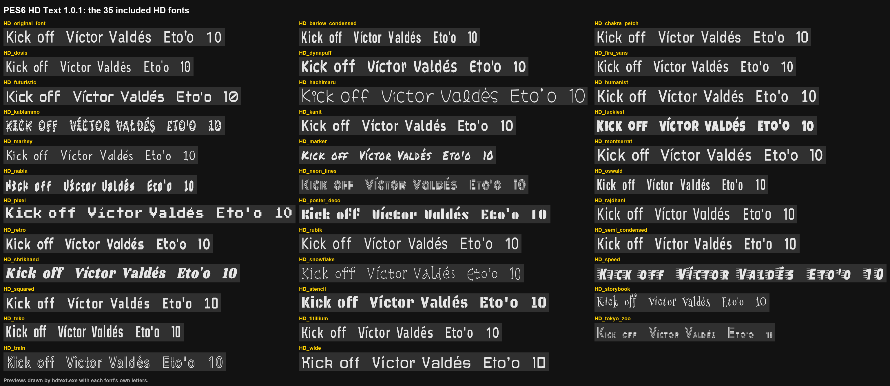

# HD fonts

The 35 HD fonts included in [PES6 HD Text 1.0.1](https://github.com/angelballay/pes6-hd-text/releases/latest), the same files that come in the download (`Kitserver\GDB\fonts`).

Each `.bin` is the game's text font (`0_text.afs` entry 53) redrawn at 4x from a free font. Letters the free font does not have (Japanese, symbols) are the game's own letters, upscaled.

**They need the PES6 HD Text DLL.** The game can't load an HD font on its own: install the mod first ([Install](../README.md#install)).

## Using one

- **With the tool:** copy the `.bin` to `Kitserver\GDB\fonts` (or use **Add font...** in `hdtext.exe`), pick it in the list and press **Apply**.
- **By hand:** see [Installing a font by hand](../README.md#installing-a-font-by-hand).

## Licenses

The source font and license of each file are listed in [FONT_LICENSES.txt](FONT_LICENSES.txt), and the license texts are in [licenses](licenses). They are modified versions of free fonts (SIL Open Font License 1.1 and Apache 2.0), not the original fonts. Twelve of them have a different name because the original name is a Reserved Font Name.

`HD_original_font` is based on work by SimoneZ (Roboto, Apache 2.0).

If you include these fonts in a patch, keep `FONT_LICENSES.txt` and the `licenses` folder with them.
